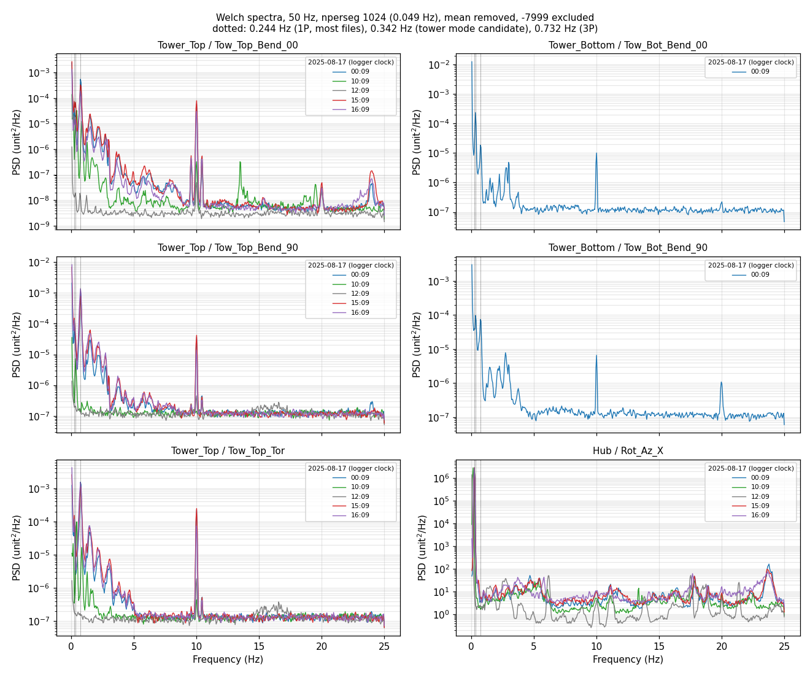

# Band proposal from Tower_Top FFT (issue #8, parent spec #1)

Status: bands confirmed by the owner, see the Decision section at the end. The rest of this note is the original proposal.

## What was read

Slow share, a handful of files, no folder listings beyond a glob on one day. All files are 10-minute Raw files in the Logger's own clock (UTC-4, ADR 0002).

| Logger | Files | Notes |
|---|---|---|
| Tower_Top | `tow_top_data_2025_08_17_0009, _1009, _1209, _1509, _1609.csv` | 5 files, 3 channels, 30,000 rows each, 0 to 1 percent `-7999` on Tower_Top, all used segments |
| Tower_Bottom | `tow_bot_data_2025_08_17_0009.csv` | only this file exists for the other four times; 2 channels |
| Hub | `hub_data_2025_08_17_0009, _1009, _1209, _1509, _1609.csv` | 15 channels; used for 1P (Rot_Az_X/Y/Z) and as an operating-state hint |
| Tower_Top, Tower_Bottom, Hub (earlier look) | `*_2020_09_04_1840, 2000, 2100, 2200, 2300` | only to check the 2020 data; see caveats |

Also seen but not used for spectra: `*_2026_11_02_18xx.csv` (live files, see caveats).

Method (scripts were run from a scratchpad and are not committed): drop the 5 metadata columns, treat `-7999` as missing, split each channel into contiguous valid runs, remove the mean of each run, Welch with 1024-sample Hann segments (50 % overlap, 0.049 Hz resolution), run spectra weighted by length and averaged per file. Peaks were re-checked with 4096-sample segments (0.012 Hz). No calibration, values stay in mV/V (tower) and mV (Rot_Az).

## What the data shows

Operating state, inferred only from the Hub Rot_Az 1P line (no Nacelle power or wind data was read for this day):

- 00:09, 15:09, 16:09: rotor at 1P = 0.244 Hz (14.6 rpm). Tower_Top std 0.014 to 0.036 mV/V.
- 10:09: rotor slower, 1P = 0.146 Hz (8.8 rpm). Tower_Top std 0.003 to 0.005.
- 12:09: no clear 1P line, tower motion 10 to 100 times lower (std 0.0005 to 0.002). Probably idling or parked; not verified.

Peaks (Hz):

| Feature | Frequency | Evidence |
|---|---|---|
| 1P (rotor rotation) | 0.244 (14.6 rpm); 0.146 (8.8 rpm) at 10:09 | Rot_Az_X/Y/Z, a gravity sine, 10^6 PSD above anything else; also visible in all tower channels |
| 3P and harmonics | 0.732, 1.46, 2.2, 2.93, 3.7 (all multiples of 3P = 0.732); 0.44 at 10:09 (3P of 0.146) | These move with rotor speed, so they are rotor harmonics, not structure. 3P dominates Tower_Top Tor and Bend_90 |
| Tower mode candidate | 0.342 | Same frequency (to 0.012 Hz) in Tower_Top and Tower_Bottom, both bend channels, in files with 1P of 0.244 and of 0.146. A line that does not move with rotor speed is structural. Strongest in Tower_Bot Bend_00 (PSD 6e-4) |
| Second structural candidate | about 2.7 to 2.8 | Tower_Bot (both channels) and Tower_Top Bend_00 at 10:09; not a multiple of 3P at the speeds seen. Weaker, not confirmed |
| 10.0 Hz and 20.0 Hz lines | 10.01, 20.0 | Narrow, present in every file and every channel, also when the tower is quiet. Almost certainly a logger or sensor excitation artefact, not structure |

Fore-aft versus side-side: the two tower natural frequencies are not separated at 0.012 Hz resolution. Both bend channels show 0.342 Hz. The sensor orientation of Bend_00 and Bend_90 (which one is fore-aft) is not documented in anything read, so the proposal below does not assign fore-aft or side-side to a channel.

Floor: PSD about 1e-7 (Tower_Bot, Tower_Top Bend_90, Tor) or 4e-9 (Tower_Top Bend_00) above about 6 Hz, so nothing useful lives above roughly 6 Hz apart from the artefact lines.

## Proposed bands (for the owner to confirm)

Same three edges for each tower bend channel, since the peaks coincide:

| Band | Edges (Hz) | Meaning | Confidence |
|---|---|---|---|
| A | 0.10 to 0.30 | 1P and its sidebands at the rotor speeds seen (0.146 and 0.244) | Medium. Owner must widen the upper edge if the rotor runs above about 18 rpm (0.30 Hz), where 1P meets the tower mode |
| B | 0.30 to 0.40 | Tower first natural frequency, centre 0.342 | Medium |
| C | 2.5 to 3.2 | Second structural candidate (2.7 to 2.8). Overlaps the 12P rotor harmonic (2.93) at 14.6 rpm | Low |

Tower_Top Tor: A (0.10 to 0.30), B (0.30 to 0.40) and D = 0.60 to 0.90 (3P at 0.732, the dominant line on this channel, moves with rotor speed so it is a rotor-excitation indicator, not a structural one). Drop C.

Hub Rot_Az_X/Y/Z (if the owner wants rotor channels covered): A only, 0.10 to 0.35, since these are 1P-dominated. Blade strain channels are out of scope of this FFT; their 1P and harmonic content (B2_Root_Flap shows 0.244, 0.488, 0.732) was only glanced at.

Keep every band away from 10 Hz: the 10 and 20 Hz lines are larger than the structural content above 3 Hz.

Band-limited RMS values measured in the proposed region (geometric mean of 00:09, 15:09, 16:09 spectra, mV/V): Tower_Top Bend_00 band 0.5 to 1.0 about 6e-3, 1 to 3 about 2.6e-3; Bend_90 about 1.1e-2 and 4.6e-3; Tor 0.5 to 1.0 about 1.3e-2. Use these only as order of magnitude.

## Caveats

1. Operating-state dependence. One day, five times, one rotor speed seen three times. Structural lines can shift with rotor speed, temperature, ice, yaw or operating state (a rotating rotor adds mass and aerodynamic damping). Fore-aft and side-side frequencies often differ by a few percent; at 0.012 Hz resolution we see a single line. A parked or idling file (12:09) was too quiet to confirm the tower mode, so the "tower mode" rests on 0.342 Hz appearing alongside two different rotor speeds only.
2. 1P overlaps the tower mode at higher rotor speed. Rated speed is not known here; the 0.244 Hz maximum seen is the only upper bound. Band A and B edges need the real operating range from the owner.
3. Seconds versus Hz. Bands as narrow as 0.10 Hz cannot be computed from one second of data with an FFT. Stage 1 will need a continuous band-pass filter (state carried across seconds, then RMS per second) and the group delay at 0.3 Hz is of the order of seconds. This is a design point for the implementing ticket, not a result of this analysis.
4. Data formats found. Raw files from 2020 and 2025 follow the spec (no header, 5 metadata columns). Live files from 2026 (for example `tow_top_data_2026_11_02_1829.csv`) have a TOA5 header, a TIMESTAMP column instead of the 5 metadata columns, only about 15,000 rows (5 minutes) and `NAN` text instead of `-7999`. The condensing code from integration/stage1 expects the older layout; the config comment already says no 2026 files for these Loggers were known. This needs a decision by the owner.
5. 2020 data (09-04 evening) was not usable for tower peaks: Tower_Top std 18 to 72 and Tower_Bot 20 to 26 with the same std in every file, dominated by very low frequency content (largest bin below 0.1 Hz), values about 1000 times larger than 2025. Possibly different gain or a commissioning state. Not analysed further.
6. Hub 2025 data has channels that are always `-7999` (B1_Root_Flap, B1_Mid_Flap, B3_Root_Flap) and channels that are mostly missing (B2_Mid_Flap, B3_Mid_Flap), so the Hub quality report will flag them.
7. Tower_Bottom had only one 2025-08-17 file among the five times tried, so its peaks come from a single file.
8. Peak picking used a log-prominence threshold and visual review; no formal significance test. The 2.7 to 2.8 Hz candidate in particular is weak.

## Open for the owner

- Confirm or change bands A, B, C, D and the Hub band.
- Say which of Bend_00 and Bend_90 is fore-aft, and whether Tower_Top Tor needs bands at all.
- Say the rotor speed range (rpm) so band A can be set safely below the tower mode.
- Say whether the 10 and 20 Hz lines are a known artefact.
- Decide how the 2026 TOA5 files are handled.

## Decision

Confirmed by the owner (issue #9):

- Tower bend channels (Tow_Top_Bend_00/90, Tow_Bot_Bend_00/90): band A 0.10 to 0.30 Hz, band B 0.30 to 0.40 Hz.
- Hub Rot_Az_X/Y/Z: band A only, 0.10 to 0.35 Hz.
- Bands C and D are not used (so Tower_Top Tor has no bands). Edges live in `config.json`.

Still unknown: the rated rotor speed range (the upper edge of A assumes 1P stays below about 0.30 Hz, about 18 rpm) and which of Bend_00 and Bend_90 is fore-aft.
